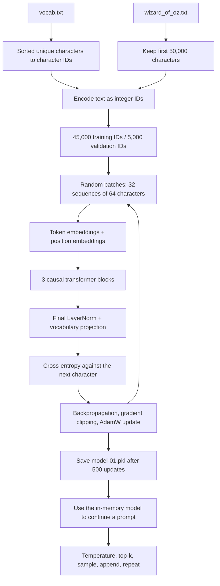

# Transformer-Based Language Model

A character-level text generation project in Python and PyTorch. The main model is a small GPT-style decoder that learns to predict the next character from the characters before it. The repository also includes a bigram baseline, tensor experiments, and an optional script for preparing a larger text corpus.

My focus in this project is the complete language-modeling pipeline: turning text into training examples, implementing causal attention and transformer blocks, optimizing next-character predictions, and generating text one character at a time. The model starts with randomly initialized weights; it does not load a pretrained language model.

The main implementation is in [`v1.ipynb`](v1.ipynb). Its default configuration uses **3 transformer blocks, 4 attention heads, 128-dimensional embeddings, and a 64-character context window**. It trains on the first 50,000 characters of the included book. This is a compact language-modeling experiment: its output is a text continuation, rather than an answer from an instruction-trained assistant.

## Project files

| File | Role |
| --- | --- |
| [`v1.ipynb`](v1.ipynb) | Main transformer: configuration, character mapping, batching, architecture, training, model saving, and prompt-based generation. |
| [`bigram.ipynb`](bigram.ipynb) | Baseline that predicts the next character using only the current character. Includes training and generated samples. |
| [`torch-examples.ipynb`](torch-examples.ipynb) | Independent experiments with tensors, embeddings, masks, matrix multiplication, softmax, and sampling. |
| [`wizard_of_oz.txt`](wizard_of_oz.txt) | Included corpus. The book inside the file is *Dorothy and the Wizard in Oz* by L. Frank Baum. |
| [`data-extract.py`](data-extract.py) | Optional preprocessing for a directory of `.xz` text files. Produces training text, validation text, and a character vocabulary. |
| [`requirements.txt`](requirements.txt) | Dependency list. The active model notebooks primarily use PyTorch and the Python standard library. |
| `vocab.txt` | Character inventory read by `v1.ipynb`. Present locally but excluded from Git; a fresh checkout needs to create it. |
| `model-01.pkl` | Model file written after transformer training. Excluded from Git and not included as a trained artifact. |

The local `data/` directory is empty and is not used by the notebooks. All active file paths are relative to the project root.

## End-to-end flow



The bigram notebook is a separate baseline. Running it helps explain the prediction task, but it is not a prerequisite for running the transformer, and its weights are not transferred to the transformer.

## 1. Text preparation and character encoding

### Vocabulary

`v1.ipynb` reads all of `vocab.txt`, takes its unique characters, and sorts them. It creates two dictionaries:

```python
string_to_int = {ch: i for i, ch in enumerate(chars)}
int_to_string = {i: ch for i, ch in enumerate(chars)}
```

`encode()` converts characters into integer IDs, and `decode()` maps those IDs back to text. Each token is one character, including spaces, punctuation, and newlines. There is no subword tokenizer, unknown-character token, or special beginning/end token. A prompt containing a character outside the vocabulary raises a `KeyError`.

The local vocabulary contains **5,520 unique characters**, although only **79 unique characters** occur in the 50,000-character training slice. Vocabulary size therefore controls the embedding/output layer size independently of how much text is used for training. A vocabulary built from the full included book contains **81 unique characters** and produces a smaller model. These vocabulary choices define different configurations; their token IDs and weights are not interchangeable.

### Training and validation split

The transformer reads `wizard_of_oz.txt` using UTF-8 and keeps `text[:50000]`. After encoding, it uses a contiguous 90/10 split:

- Training: the first **45,000** character IDs.
- Validation: the remaining **5,000** character IDs.

The split happens before batch sampling. Training windows come only from the training portion, and validation windows only from the validation portion. The notebook loads the book into memory; it does not read the text files produced by `data-extract.py`.

### Input and target batches

`get_batch(split)` chooses 32 random starting positions. At each position, it takes 64 consecutive characters as input and the same window shifted one character forward as the target.

For a shorter illustrative window:

```text
Text:     Dorothy
Input:    D o r o t h
Target:   o r o t h y
```

Each position contributes a next-character prediction. Both `x` and `y` have shape `[32, 64]`, so one optimizer update learns from **2,048 target positions**. Windows can overlap or be sampled again. The 500 iterations are optimizer updates, not 500 full passes through the book.

## 2. Transformer architecture

The architecture is defined by `CausalSelfAttention`, `FeedForward`, `Block`, and `GPTLanguageModel` in `v1.ipynb`.

### Embeddings

Each character ID maps to a learned vector of length 128. A second embedding table supplies a learned vector for each position from 0 to 63. Adding them gives the model both character identity and position information:

```text
x = token_embedding(character_ids) + position_embedding(positions)
```

The position embeddings are learned parameters, rather than fixed sinusoidal values.

### Causal multi-head self-attention

Attention lets a character position use information from earlier positions in its current context.

1. A single linear layer projects each 128-dimensional vector into 384 values.
2. These values split into queries, keys, and values, each of width 128.
3. Each is reshaped into four heads, giving **32 dimensions per head**.
4. `F.scaled_dot_product_attention(..., is_causal=True)` computes attention. Conceptually, each head applies `softmax(QKᵀ / sqrt(32) + causal_mask)` to `V`.
5. The four head outputs are joined, projected back to width 128, and passed through dropout.

The causal restriction means position `t` can attend only to positions `0` through `t`. It cannot look at the future character it is being trained to predict. All 64 training predictions can therefore be computed together without exposing their future targets.

The attention class also registers a lower-triangular `mask` buffer, but `forward()` does not use that buffer. The active masking comes from `is_causal=True`. Attention computation is delegated to PyTorch; the project does not implement a custom Flash Attention kernel.

### Feed-forward network and residual connections

Each block applies attention followed by a feed-forward network:

```python
x = x + self.attn(self.ln1(x))
x = x + self.ffwd(self.ln2(x))
```

This is a pre-LayerNorm layout: normalize the input to each sublayer, compute its transformation, then add it back through a residual connection. Attention mixes information across positions. The feed-forward network transforms each position's features independently:

```text
128 → Linear → 512 → GELU → Linear → 128 → Dropout
```

The model stacks three blocks. Dropout is `0.1` in attention and the feed-forward path during training.

### Output projection, weight tying, and initialization

A final LayerNorm is followed by a linear projection to `vocab_size` scores per position. These raw scores are the **logits**.

The token embedding and output projection share the same weight parameter. For vocabulary size `V`, one `[V, 128]` matrix serves both operations instead of two independent matrices. With the default architecture, the number of unique trainable parameters is:

```text
601,728 + 128 × V
```

That gives **1,308,288 parameters** with the local 5,520-character vocabulary, or **612,096 parameters** with the 81-character book vocabulary.

Linear and embedding weights use normal initialization with standard deviation `0.02`, and linear biases are zeroed. The attention output projections (`c_proj.weight`) are then initialized with the smaller standard deviation `0.02 / sqrt(2 × n_layer)`. This extra scaling applies to the attention projection; the feed-forward output layer does not receive that special initialization in the current code.

### Tensor shapes through one forward pass

Here `B = 32`, `T = 64`, `C = 128`, and `V = vocab_size`.

| Stage | Shape |
| --- | --- |
| Input character IDs | `[32, 64]` |
| Token embeddings | `[32, 64, 128]` |
| Position embeddings, broadcast across the batch | `[64, 128]` |
| Combined embeddings | `[32, 64, 128]` |
| Fused query/key/value projection | `[32, 64, 384]` |
| Each of Q, K, and V after splitting into heads | `[32, 4, 64, 32]` |
| Joined attention output | `[32, 64, 128]` |
| Feed-forward hidden representation | `[32, 64, 512]` |
| Output of each block and final LayerNorm | `[32, 64, 128]` |
| Vocabulary logits | `[32, 64, V]` |
| Logits flattened for training loss | `[2048, V]` |
| Flattened targets | `[2048]` |

With targets provided, `forward()` returns flattened logits and the loss. Without targets, it returns three-dimensional logits and `None` for the loss.

## 3. Training and evaluation

### Default configuration

| Setting | Value |
| --- | --- |
| Batch size | 32 |
| Context window (`block_size`) | 64 characters |
| Optimizer updates (`max_iters`) | 500 |
| Embedding width | 128 |
| Attention heads | 4 |
| Transformer blocks | 3 |
| Dropout | 0.1 |
| Peak learning rate | `3e-4` |
| Warmup | 50 updates |
| Cosine schedule minimum | `3e-5` |
| AdamW betas | `(0.9, 0.95)` |
| Weight decay | 0.1 |
| Gradient clipping maximum norm | 1.0 |
| Evaluation frequency | Every 50 updates, including step 0 |
| Evaluation samples | 50 batches per split at each evaluation |

### What happens at each update

1. `get_lr(iter)` computes the learning rate and assigns it to the optimizer.
2. At steps `0, 50, ..., 450`, `estimate_loss()` measures training and validation loss before that step's update.
3. `get_batch('train')` samples a fresh input/target batch.
4. The model produces logits, and `F.cross_entropy()` measures their next-character prediction loss. It receives raw logits; no separate softmax is applied before the loss.
5. `optimizer.zero_grad(set_to_none=True)` clears previous gradients.
6. `loss.backward()` computes gradients.
7. `clip_grad_norm_(..., 1.0)` limits the global gradient norm.
8. `optimizer.step()` updates the weights with AdamW.

The learning rate begins at `6e-6`, reaches `3e-4` over the first 50 updates, and then follows cosine decay toward `3e-5`. The loop ends at index 499, so the last scheduled value is slightly above that minimum.

`estimate_loss()` temporarily switches to evaluation mode, disables gradient tracking, averages cross-entropy over 50 random batches for each split, and returns the model to training mode. Validation estimates come from sampled windows, rather than a complete deterministic pass over the validation text.

The final printed loss is the last training batch's loss, calculated before its optimizer update. The notebook does not perform a separate final validation evaluation or select a best-validation checkpoint.

### Saving

After training, `pickle.dump()` serializes the model object to `model-01.pkl`. The following generation cell uses the existing in-memory model; it does not reload that file.

This is not a complete resumable experiment checkpoint: the character dictionaries, optimizer state, current iteration, and configuration are not saved alongside the model. Reusing it requires matching class definitions, vocabulary ordering, configuration, and device setup. A portable `state_dict` checkpoint with this metadata would be a useful next addition.

## 4. Text generation

The final transformer cell starts from:

```python
prompt = 'Hello! Can you see me?'
```

The prompt is encoded and reshaped from `[T]` to `[1, T]`. `generate()` repeats the following process 100 times:

1. Keep only the latest 64 character IDs as model input.
2. Compute logits for that context and take the final position's logits.
3. Divide by the temperature, defaulting to `0.8`.
4. Apply top-k filtering, defaulting to `40`: scores below the kth-highest score become negative infinity. Ties at the cutoff may retain more than k candidates.
5. Apply softmax to obtain probabilities.
6. Sample one character with `torch.multinomial()`.
7. Append it to the full sequence and repeat.

`decode()` converts the full sequence back to text. The printed output includes the original prompt followed by 100 new characters. There is no end-of-sequence stopping rule.

A lower positive temperature sharpens the sampling distribution; a higher value flattens it. Setting `top_k=None` disables top-k filtering. Temperature must be positive, and a provided top-k value should be a positive integer.

The returned sequence can exceed 64 characters, but each prediction sees only the latest 64. Positions are numbered again from zero within each cropped window. The implementation recomputes the window on every step and does not use a key/value cache.

**Current generation behavior:** the final notebook cell does not call `eval()` or disable gradient tracking. Training leaves the model in training mode, so dropout remains active during that cell. For inference after training, use this form in a notebook cell:

```python
prompt = 'Hello! Can you see me?'
context = torch.tensor([encode(prompt)], dtype=torch.long, device=device)

m.eval()
with torch.no_grad():
    output = m.generate(
        context,
        max_new_tokens=100,
        temperature=0.8,
        top_k=40,
    )
print(decode(output[0].tolist()))
```

This disables dropout and gradient tracking for inference. Sampling remains random. Call `m.train()` before resuming training.

## 5. Bigram baseline

[`bigram.ipynb`](bigram.ipynb) isolates the basic next-character task. Its only trainable layer is `nn.Embedding(vocab_size, vocab_size)`: each current character selects a row containing scores for the next character.

| Property | Bigram baseline | Transformer |
| --- | --- | --- |
| Information used for one prediction | Current character only | All available preceding characters in the current window |
| Dataset | Entire included book | First 50,000 characters |
| Vocabulary | Built directly from the book | Read from `vocab.txt` |
| Train/validation split | 80/20 | 90/10 |
| Batch size | 4 | 32 |
| Training window | 8 | 64 |
| Updates | 1,000 | 500 |
| Learning rate | Constant `3e-4` | Warmup and cosine decay |
| Generation | Full-distribution sampling | Temperature and top-k sampling |
| New characters in the sample cell | 500 | 100 |

An eight-character bigram input window supplies eight training targets, but the baseline does not combine those characters into a context representation. Each prediction still depends only on the character at that position.

The baseline generates once before training and again afterward. Its starting context is token ID zero, which maps to a newline for the included corpus. Unlike the transformer, it does not save a model file.

The saved baseline output includes a validation loss of `2.825` at displayed step 750. That is an existing notebook output, not a newly reproduced result: execution counts show cells were run out of order or repeated. The transformer notebook has no saved training results. A fair comparison would require the same corpus, vocabulary, split, and controlled evaluation procedure for both models.

## Running the project

### 1. Create an environment

Run these commands from this project directory in PowerShell. The separate environment name avoids relying on the workspace's existing local environment.

```powershell
python -m venv .venv-readme
.\.venv-readme\Scripts\python.exe -m pip install --upgrade pip
.\.venv-readme\Scripts\python.exe -m pip install torch numpy jupyter ipykernel
.\.venv-readme\Scripts\python.exe -m ipykernel install --user --name transformer-lm --display-name "Transformer LM"
```

Use a PyTorch installation that provides `torch.nn.functional.scaled_dot_product_attention`. The transformer selects CUDA when available, then Apple MPS, and otherwise CPU. The bigram and tensor notebooks select CUDA or CPU. CPU execution is supported, though training time depends on the machine.

`requirements.txt` additionally lists `pylzma`, `tokenizers`, `tqdm`, and `transformers`. The current model notebooks do not use the `tokenizers` or `transformers` packages. The extraction script uses `tqdm` and the standard-library `lzma` module, rather than importing `pylzma`. Jupyter and NumPy are included explicitly above because the requirements file does not list them.

### 2. Prepare the vocabulary if it is missing

`vocab.txt` is ignored by Git. To run from a fresh checkout with the included book, save and run this Python snippet from the project root, or execute it in a notebook cell before running `v1.ipynb`:

```python
from pathlib import Path

vocab_path = Path("vocab.txt")
if vocab_path.exists():
    print("Keeping the existing vocab.txt")
else:
    text = Path("wizard_of_oz.txt").read_text(encoding="utf-8")
    chars = sorted(set(text))
    vocab_path.write_text("".join(chars), encoding="utf-8")
    print(f"Created vocab.txt with {len(chars)} characters")
```

This keeps an existing vocabulary intact. A new vocabulary uses the full book's character inventory, while `v1.ipynb` still trains on only its first 50,000 characters. Keep the same vocabulary ordering when reusing trained weights. Changing the vocabulary requires rebuilding the model and retraining.

### 3. Run the notebooks

```powershell
.\.venv-readme\Scripts\python.exe -m jupyter notebook
```

Select the **Transformer LM** kernel. The notebooks contain older saved kernel names; the matching environment must be selected locally.

For the main model, open `v1.ipynb`, restart the kernel, and run all eight cells from top to bottom:

| Cell | Action |
| --- | --- |
| 1 | Import libraries, select the device, and define hyperparameters. |
| 2 | Read the vocabulary and calculate its size. |
| 3 | Define character encoding and decoding. |
| 4 | Load the text slice, create the split, and define batch sampling. |
| 5 | Define the model classes and instantiate the transformer. |
| 6 | Define training/validation loss estimation. |
| 7 | Train for 500 updates and write `model-01.pkl`. |
| 8 | Continue the prompt with the in-memory model. |

Expect a device name, dataset sizes, parameter count, periodic loss values, a save message, and generated text. The model file is overwritten when the training cell completes again. Rerunning the training cell without rebuilding the model continues from its existing weights while resetting the optimizer and schedule.

For a conceptual walkthrough, read `torch-examples.ipynb`, then run `bigram.ipynb`, and finally run `v1.ipynb`. The tensor notebook is scratch work rather than a required executable pipeline: its timing experiment creates very large tensors, and its flattening example indexes a two-dimensional tensor with three indices, producing an `IndexError`.

## Optional larger-corpus preprocessing

`data-extract.py` is separate from the active book-training path. It expects a directory named `openwebtext` containing directly readable UTF-8 `.xz` text files. Install `tqdm` in the chosen environment if using this script.

Its current flow is:

1. List `.xz` files using `os.listdir()`.
2. Assign the first 90% of listed filenames to training and the rest to validation. The list is neither sorted nor shuffled first.
3. Randomly sample 1% of each split, with a minimum requested sample of one file per split.
4. Clear `output_train.txt` and `output_val.txt`.
5. Use four worker processes to decompress files and append their contents to the corresponding output file.
6. Collect the union of characters from both sampled splits and write the sorted characters to `vocab.txt`.

The 1% sample is by **file count**, not bytes or character count. Sampling is unseeded, and both file splits must be nonempty. Each selected file is read fully into memory.

Before using this path on Windows, move top-level execution into an `if __name__ == "__main__":` guard so spawned workers do not rerun the script. The current workers also append to the same file concurrently, so output ordering is not controlled and writes should be coordinated before relying on the resulting corpus. Running the script replaces the output text files and vocabulary.

To train on these outputs, the data-loading cell in `v1.ipynb` would need to read and encode `output_train.txt` and `output_val.txt` separately. Merely running extraction does not switch the notebook away from the book dataset.

## Current scope and next improvements

The project implements character encoding, a bigram baseline, a causal transformer, training/validation loss estimation, scheduled optimization, model serialization, and autoregressive sampling. The transformer notebook does not include recorded benchmark results, a deployed interface, instruction tuning, or a portable inference entry point.

The main constraints are the small training slice, 64-character context, and short training run. There is no fixed random seed, so initialization, sampled batches, and generated text vary between runs. A vocabulary much larger than the training character set adds output classes that receive no positive training targets.

The next changes I would prioritize are:

1. Make vocabulary creation part of the main notebook and save the exact character mapping with each checkpoint.
2. Use evaluation mode and disabled gradient tracking in the generation cell.
3. Save model state, optimizer state, hyperparameters, and training step together.
4. Record reproducible loss curves and compare both models on an identical split.
5. Make larger-corpus extraction deterministic and safe for multiprocessing before connecting it to training.

These are follow-up improvements; the sections above describe the implementation currently in the repository.
